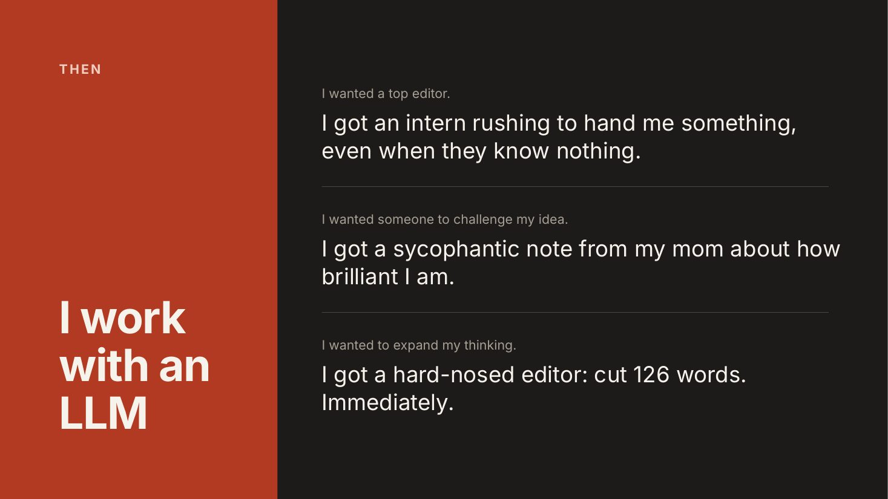
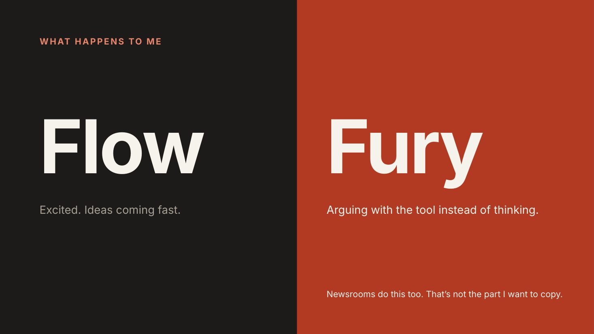
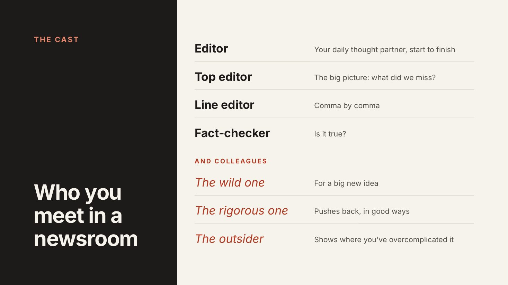
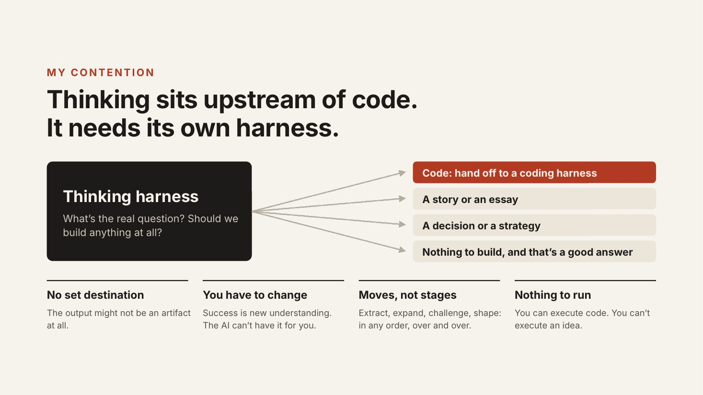
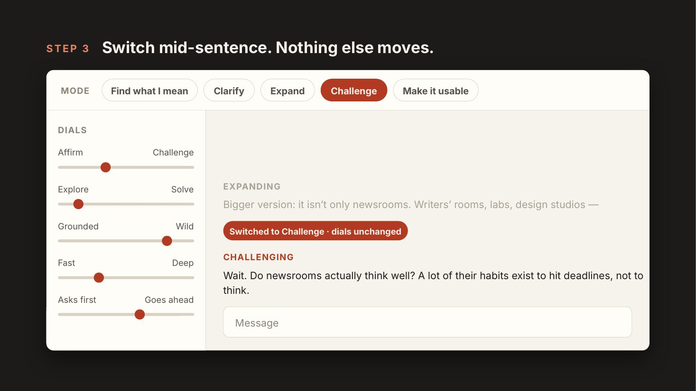
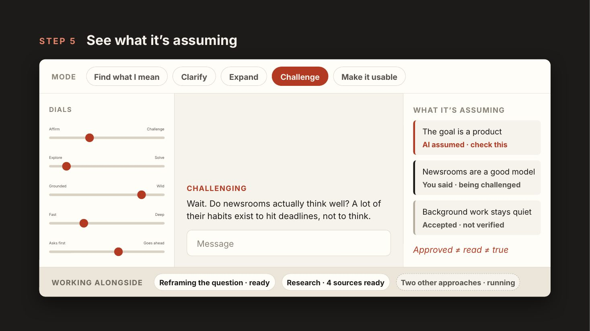
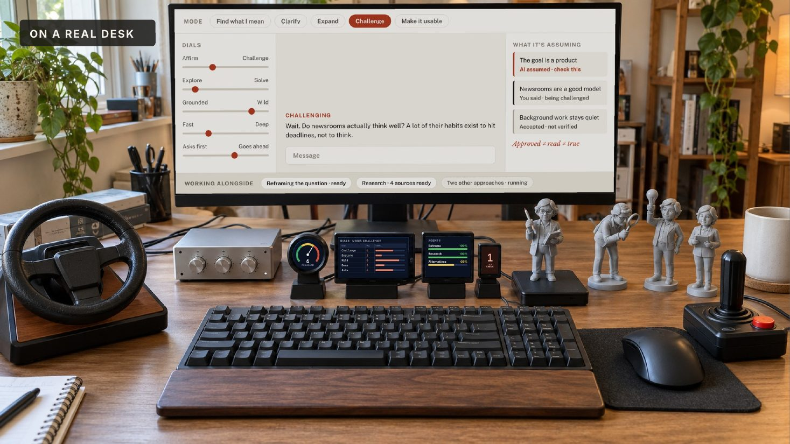

# Thinking Harness

**An open exploration of how to build better conditions for thinking with AI.**

I think there's still a lot of room to build tools around large language models (LLMs) that help people think more effectively. I'm calling this a *thinking harness*, although I'm not sure "harness" is the right word, and I'm not sure we understand "thinking" well enough yet either. This repo is a place to work that out in the open. It includes an essay on the problem, an early working app, a plan for what to build next, and the Foo Camp talk where the idea started.

## The problem

I use AI as a thought partner all the time, and I keep hitting a mismatch between the kind of help I need and the kind I get.



On their own, and even inside today's harnesses and tools, LLMs often struggle to understand what mode they're in or what phase of the work they're supporting:

- They can be too proactive when you want them to be reflective, and too reflective when you want them to act.
- They can be overly critical when you want help exploring an idea, and sycophantic when you want a real critique.
- Ask for a big-picture edit and you get the whole thing rewritten. Ask for a speech you've already talked through and you get more questions. Ask for help with a half-formed idea and it's turned into a plan before you know what you think.

Some of my conversations while preparing the Foo Camp talk were wonderful. Others kept forcing me to execute, kept raising objections that didn't matter, and one seemed oddly committed to never saying anything negative about a news organization I'd worked at. In each of those moments, I was managing the collaborator instead of thinking about the idea.



It's a familiar arc. You start excited, in flow, with ideas coming fast. Then the model gives the wrong kind of help a few times in a row, and you go from flow to frustration to genuinely arguing with a tool. The thinking stops.

There's a quieter problem too. AI produces documents faster than anyone can read them. You approve one without reading it closely, and a wrong assumption buried in it becomes the foundation for everything after. **Approved doesn't mean read. Read doesn't mean true.** And the more you know about a subject, the more you notice how plausible-but-wrong the details can be. I don't want an AI subtly reshaping views I've spent years forming.

## What editorial work already knows

The main insight behind this project comes from editorial work. I've worked at NPR, This American Life, Planet Money (which I co-founded), The New York Times Magazine and The New Yorker. They all start with the same raw material: a vague idea, a provocation, a news event, something that isn't a story yet. Each has a very different culture for turning it into something worth telling. NPR pushes hard toward execution. At This American Life, an idea could be discussed openly for days. I found that I thought differently in each place, and at The New Yorker I became a significantly better writer without changing who I was. It wasn't that they only hire the best writers. It was the system: how the organization structured thinking.

Every news organization structures its editorial process differently, but all of them include **discrete phases**: developing ideas, challenging them, expanding them, shaping them, and turning them into refined output. And they have well-understood roles for each kind of help:



Everyone knows what a top edit is and when it happens. Nobody expects the fact-checker to rewrite your lede or the line editor to question the premise. The best professionals also know that phases aren't linear. Real pros start with terrible first drafts, because early on you're in a different phase entirely, where quantity beats quality and you're still feeling out what's interesting. The sentence you expected turns into 3,000 words, and the 3,000 words you planned don't make it in. What matters is knowing which phase you're in at any moment.

This is exactly what LLMs get wrong, and what editorial operations have largely solved, or at least made great strides on, by establishing **well-understood modes, roles, responsibilities and phases**. (Newsrooms also have their failures: bad editors, deadline habits that crowd out thinking, and a house style everyone slowly absorbs. Those aren't the parts worth copying.)

## The opportunity

So the starting point is this: use what editorial work knows to make LLMs better thinking partners. The goal is a richer expression of people's *own* ideas: ideas that are more distinct, more powerful, more rigorous, more widely researched and more impactful. The aim is a harness that helps *you* think well, not one that thinks for you. One person in the Foo Camp room put the distinction sharply: "Are you trying to build a harness that thinks well, or a harness that makes me think well?"



Coding tools have advanced fast, partly because a lot of craft has gone into the harnesses around the models. Thinking hasn't had the same attention, and I don't think solving coding automatically solves thinking. Thinking sits upstream. Before anyone writes code or a story, someone has to ask what the real question is and whether anything should be built at all. The result might be code, a story, a decision or nothing, and nothing can be a good answer. Thinking also has no set destination. Success means *you* understand something new, which the AI can't do for you. The moves come in any order, over and over. And you can execute code and watch what happens, but you can't execute an idea, so you have to keep track of what you're trusting.

As someone at Foo Camp said, it feels like 1994, when Mosaic had just shipped and nobody knew what web apps would look like. Most knowledge work isn't coding, and most people still face a blank box with no idea what to do with it. We don't know what thinking tools should look like yet.

## What a thinking harness might do

The core idea is simple: **you choose how you want to think with the AI right now. The harness holds that choice. And you can change it whenever you want, instantly.**



- **Pick the kind of thinking:** find what I mean, clarify, expand, challenge or make it usable.
- **Set the dials:** affirm versus challenge, explore versus solve, grounded versus wild, fast versus deep, and how much it does without asking.
- **Switch mid-sentence:** tap Challenge halfway through a reply, and it changes course right then. Nothing else moves: asking for more pushback doesn't mean it gets to start solving.
- **Let work happen alongside you:** background agents question the framing, gather research and try different approaches. They wait until you want them instead of interrupting.
- **See what it's assuming,** and where each assumption came from: did you say it, did the AI propose it, did anyone verify it? It should show only the few that matter, at a volume you can actually check.



That last point is the hardest problem, and journalism already has an answer. You don't ask the reporter whether the story is true. The fact-checker goes back to the sources. A thinking harness should record where every claim came from as it's written, instead of trusting the model's account of itself.

Thinking is also physical. We think with our hands, our bodies and the space around us. A harness could be a screen, but it could also be knobs, a steering wheel and a joystick for turning the dials without breaking your train of thought, small displays showing the state at a glance, and figurines you set on an NFC reader: the editor, the fact-checker, the wild one, the outsider. *That's who I'm talking to now.*



## Is "harness" the right word?

I'm not sure. Some questions from the Foo Camp room that I'm still thinking about:

- **Is it a harness at all?** One person argued that "harness" implies something linear: you, chatting with a model. Maybe the better idea is a *medium* or a *studio*, a document or canvas you speak to and that speaks back to you in many ways.
- **Should it obey you, or read you?** Sometimes you want to set the mode yourself. Sometimes you want something like a good mentor, who notices what you need ("you think you want more ideas, but you need to narrow down") and suggests the right mode.
- **Modes or personas?** Summoning a perspective, like a demanding editor or a particular expert, changes the output a lot. But people also want those voices in the right doses, at the right time, and want to be able to send them away.
- **How do we keep it from shaping us?** Every newsroom has a house style that people absorb without noticing, and LLMs have one too. A thinking tool should make your ideas more yours, not more like everyone else's.

## What's here so far

This is early. The [app in this repo](#quick-start) is a first, small experiment. It's a browser-based instrument with four persistent dials (implementation, wildness, thinking effort and critique) and five partnership modes, which shape every reply and record the exact settings behind each one. It runs locally in demo mode with no account, or with your own OpenAI key. It doesn't yet switch mid-reply, run background agents or track assumptions.

- [`nextsteps.md`](nextsteps.md): an honest assessment of the app, what we've learned, and a plan for what to build and test next.
- [`talk/`](talk/index.html): the Foo Camp slides and talk text, and the anonymized [session transcript](talk/transcript.html). Download them and open them in a browser, since GitHub shows HTML as code.
- [`proposal.html`](proposal.html): the original design proposal for a physical thinking instrument.
- [`docs/PHYSICAL_OBJECT_IDEAS.md`](docs/PHYSICAL_OBJECT_IDEAS.md): design notes on physical objects as thinking partners.

## An invitation

This is an invitation to explore the idea together. I'd love your help, whether that's a comment or a pull request:

- **Open an issue** with ideas, objections, examples of tools that help you think, or modes and roles we've missed.
- **Send a pull request** or fork the repo to try your own version.
- **Share what works for you.** Tell us which people help you think well and what they're actually doing. That's the raw material for this.

The app is MIT licensed, so you're free to reuse and adapt it.

---

# Using the app

You steer the conversation with four persistent dials and five partnership modes (Play, Extract, Boss, Buddha, Influencer) instead of rewriting your prompt each time. Conversations, dial positions and the settings used for every reply are saved locally.

The app runs as a small local Node server with no dependencies and no build step, on any machine with Node: a laptop, a desktop or a home server such as a Raspberry Pi. You use it in a browser with a keyboard and mouse, or optionally from a phone.

## Quick start

You need [Node.js](https://nodejs.org/) 24 or newer. There is nothing to `npm install`.

```bash
git clone https://github.com/adamjdavidson/foo_thinking_harness.git
cd foo_thinking_harness
npm start
```

Open http://localhost:8787 and enter the **pairing code** printed in the terminal. Press Ctrl-C to stop the server.

The app starts in **demo mode**. Demo mode makes no network requests and returns clearly labeled placeholder replies, so you can try the dials, modes and saved conversations for free. To get real replies, [connect an OpenAI API key](#connect-live-ai).

To use a different port, run `PORT=8790 npm start`.

## Connect live AI

Live replies use the OpenAI Responses API and are billed to your own OpenAI account.

1. Create a project API key at [platform.openai.com](https://platform.openai.com/api-keys).
2. In the app, open **API setup**, paste the key, set a total **budget** in dollars, and select **Connect live AI**.

The server checks that the key can access the model, then switches to live mode immediately. The key is saved to `data/api-settings.json` (owner-only permissions) and restored on restart. It is never sent to the browser, saved in browser storage or included in exports. To change the key or budget later, reopen **API setup**. Leave the key field blank to keep the saved key.

If you prefer configuring by file, copy `.env.example` to `.env` and set:

```dotenv
PILOT_MODE=live
OPENAI_API_KEY=your-project-key
PILOT_BUDGET_USD=10
```

Settings saved through **API setup** take precedence over `.env`.

**Model:** conversations use `gpt-6.1-sol`, and the Effort dial maps to `reasoning.effort` (`low` to `max`). Speech input uses `gpt-transcribe`. No fallback model is chosen silently.

**Budget:** before each paid request, the app reserves a conservative cost estimate in a local SQLite ledger and refuses requests that would exceed your total. The estimate assumes $3/$15 per million input/output tokens, above the published rates when this was written, and up to 8,192 output tokens per reply. Once a reply returns, the unused part of its reservation is released. The budget is a running total across restarts, not a per-session allowance. This is local accounting, not a hard cap on your OpenAI account, so your OpenAI billing dashboard is the authority. Failed requests keep their reservation, and nothing is retried automatically. Start with the Effort dial at Medium. Higher efforts can use up the output allowance on reasoning.

Each request sends the visible text history of the current conversation plus the current dial and mode instructions, with `store: false`. Nothing is attached to your ChatGPT account.

## Using it

### Dials

There are four five-position dials. Their defaults are **Make it happen / Fresh twists / Medium / Balanced**. The meaning of the selected dial appears below the dial bank.

- **W/S or ↑/↓** selects the previous or next dial.
- **A/D or ←/→** moves it down or up (1 to 5).
- You can also click a dial title, a numbered position or the on-screen arrows.
- **Ctrl/Cmd+Enter** sends. **Esc** in the message box returns focus to the dials without losing your draft. Steering keys behave normally while you're typing.

Dial positions save with each conversation, and new conversations inherit the current positions. If you change a dial while a reply is in progress, the change applies to your next message. **Settings used** under each reply shows exactly what it was generated with.

### Partnership modes

Press an image tile above the conversation to choose a mode. Tab and Enter/Space also work.

- **Play:** explore freely, make connections and generate possibilities.
- **Extract:** pull out insights, decisions, open questions and next steps, separating real decisions from suggestions.
- **Boss:** shape the work around your boss's priorities, anticipate objections and present it persuasively. Tell it what your boss cares about in the conversation.
- **Buddha:** step back, notice attachments and assumptions, and find clarity and a compassionate next step.
- **Influencer:** a fashion-model and social-media lens focused on audience, image, attention, packaging and presentation.

A mode is saved per conversation and combines with the dials. Mode and dial meanings live in `public/modes.js` and `public/controls.js` if you want to change them.

**Tile images:** the Boss, Buddha and Influencer tiles use AI-generated figurines of fictional people. To personalize one, replace its file in `public/images/` with any square PNG, such as a photo of your own boss for `boss.png`. Generation prompts are in [`public/images/README.md`](public/images/README.md).

### Conversations

The menu switches between saved conversations. **Export** downloads a conversation, with the settings used for each reply and token counts, as JSON. Each conversation runs one reply at a time. Replies appear when complete. Conversations are capped at about 160 KB of text, and the app will ask you to export and start fresh rather than silently dropping older turns. Use a single browser tab at a time.

## Optional: use a phone as the controller

You can run the server on one machine (for example, an always-on Raspberry Pi) and use a phone as the controller. The phone layout was designed on a Galaxy Fold. Turn on **Phone controls** in the app for mirrored **Talk** and **Adjust** buttons:

- **Talk:** hold to record and release to send (speech is transcribed, up to 90 seconds).
- **Adjust:** hold and tilt the phone left/right to move the selected dial.

The server only listens on `127.0.0.1`. To reach it from a phone, use [Tailscale Serve](https://tailscale.com/kb/1312/serve) so it is reachable only on your private tailnet:

```bash
tailscale serve --bg http://127.0.0.1:8787
# or, if HTTPS 443 is already in use:
tailscale serve --bg --https=8443 http://127.0.0.1:8787
```

Then put the exact HTTPS address Tailscale prints (no trailing slash) in `.env` and restart:

```dotenv
APP_ORIGIN=https://your-machine.your-tailnet.ts.net:8443
```

Open that address on the phone, enter the pairing code, and use **Device check** to enable the microphone and motion sensors. `bash scripts/setup-pilot.sh` walks through these steps interactively. Don't use Tailscale Funnel, and don't bind the app to a public interface. [`docs/DEVICE_CHECK.md`](docs/DEVICE_CHECK.md) lists the on-device acceptance checks.

## Your data

Everything is stored under `data/`, which is gitignored:

- `data/pilot.sqlite` stores conversations, dial values, token usage and the budget ledger. It is not encrypted. To back up, stop the server and copy the whole `data/` folder.
- `data/pairing-code` is the browser pairing secret. To sign out all browsers, stop the server, delete this file and restart.
- `data/api-settings.json` stores your API key and live settings.

Audio is held in memory only and sent to OpenAI for transcription. The transcript is stored locally. The app has no tools, web access or code execution; it only produces text.

## Development

```bash
npm test         # 38 offline tests: app logic, HTTP routes, browser event handlers
npm run check    # JavaScript syntax check and proposal.html integrity check
```

The tests make no network requests. The browser tests run the real `public/app.js` handlers against a simulated DOM, so they don't cover layout or real devices.

| File | Responsibility |
|---|---|
| `src/server.js` | Starts the loopback server, reads config, creates the pairing code |
| `src/http.js` | Authenticated routes and static assets |
| `src/pilot.js` | Turns, live configuration, budget gating |
| `src/provider.js` | OpenAI Responses and transcription calls |
| `src/store.js` | SQLite persistence and migrations |
| `src/api-settings.js` | Private API-key persistence |
| `public/app.js` | Browser UI (keyboard and phone) |
| `public/controls.js` | Dial meanings and instructions |
| `public/modes.js` | Partnership modes |
| `public/motion.js`, `public/audio.js` | Tilt clutch and recording |

**Known limitations:** dial changes during a reply apply to the next message only. Replies aren't streamed. Audio capture uses the deprecated `ScriptProcessor` API. Phone sensors and the extreme dial positions haven't been fully calibrated on a real device. Ideas for physical controllers (NFC objects, cockpit-style displays) are in [`docs/PHYSICAL_OBJECT_IDEAS.md`](docs/PHYSICAL_OBJECT_IDEAS.md).
